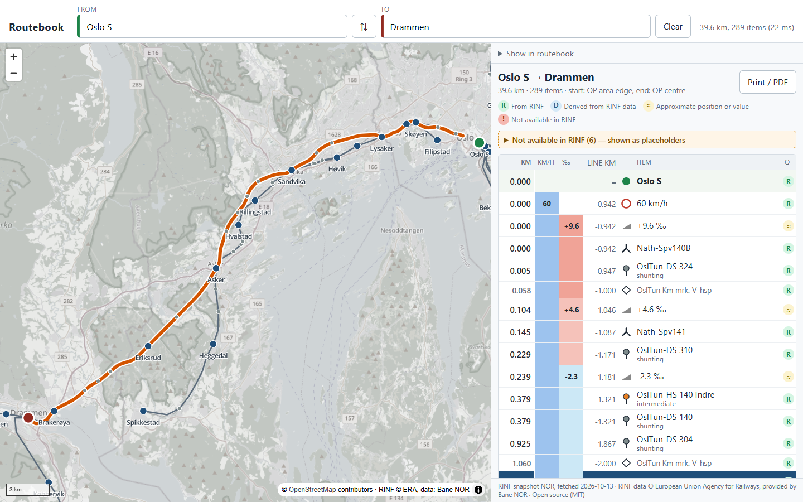

# Routebook

[](https://github.com/Matdata-eu/rinf-routebook/actions/workflows/ci.yml)
[](https://github.com/Matdata-eu/rinf-routebook/pkgs/container/rinf-routebook)
[](LICENSE)

**An open-source railway routebook built on public ERA RINF data.** Pick two stations. Routebook computes the route on the track-level (micro) topology of the RINF knowledge graph. It then shows what a driver meets along the way, in order: line changes, speed, gradient, tunnels, signals, switches, km posts and stations. Wherever RINF has no data for something a routebook needs, the routebook says so explicitly instead of guessing.

It works for any network the [ERA knowledge graph](https://graph.data.era.europa.eu/) publishes with its micro topology: pick a country, an infrastructure manager or a combination of them.



<sub>Oslo S → Drammen: route on the map (left) and the routebook strip (right) with distance, speed band, gradient band, line km and a quality flag per item. More: [schematic view](docs/screenshots/oslo-drammen-schematic.png), [drive view](docs/screenshots/drive-chase.png), [Oslo S → Bergen](docs/screenshots/oslo-bergen.png), [tablet](docs/screenshots/oslo-drammen-tablet.png), [print view](docs/screenshots/oslo-drammen-print.png).</sub>

## Features

- **Route on the micro topology** between any two operational points, in the browser, in tens of milliseconds (73 ms for Oslo S → Bergen, 455 km and 3 800 items).
- **Routebook strip** with speed and gradient bands, line km, signals, switches, tunnels, level crossings and km posts, a quality flag per item (from RINF, derived, approximate, missing), and a print / PDF layout.
- **Section parameters** from RINF along the route: energy supply and contact line, class B and other train protection, ETCS level and baseline, GSM-R, gauge, gauging, line category and raised pantographs, with an item where one changes and the phase and system separations. Where a value is missing, the app says whether the infrastructure manager declares it *not applicable* or *not yet available*, or RINF does not say.
- **Line strip**: the route as vertical bands like a paper route book (speed, gradient, energy, class B, ETCS, GSM-R, tunnels), 2 to 60 km per screen, ahead up or down, with a section card for any point and a train to follow ([screenshot](docs/screenshots/oslo-bergen-strip.png)).
- **Timetable**: set a departure time and the stops for passing and stop times at every operational point, from a simulated run at the RINF maximum speeds.
- **Schematic** track diagram of the route, with the surrounding tracks and switches on the correct side.
- **Drive** view: a satnav-style camera follows a train along the route, with the next signal, speed change or station ahead.
- **All of RINF at once**: the map and the search cover every fetched dataset from a small index; a network's data is loaded the moment a route needs it, and the **Network** picker narrows the view to one.
- **Routes across networks**: RINF has no connections between infrastructure managers, so Routebook derives border links (shared border points, or border points within 300 m) and routes Oslo to Stockholm over them, with an *Infrastructure manager change* item in the routebook and every dataset's publication in the footer.
- **Know your dataset**: the app names the ERA publication (infrastructure manager, dataset id, publication date, fetch time) behind every network and every printed routebook, lists all datasets with their status in a [**Datasets** dialog](docs/screenshots/datasets-dialog.png), and links each one to [RINF Atlas](https://github.com/Matdata-eu/rinf-atlas).
- **Always current**: the server checks ERA every hour and fetches only the datasets that changed, with the previous data on offer until the new one is in place; see [docs/datasets.md](docs/datasets.md).
- **Your own map layers**: add orthophotos, satellite imagery or WMS overlays with API keys that stay on the server, or serve the street map yourself from one [PMTiles](https://docs.protomaps.com/pmtiles/) file.
- **Works offline**: an installable web app that keeps the app, the networks opened and a self-hosted map for use without a network.
- **Your own privacy statement**, linked in the footer.
- **Docker image** and Docker Compose file; a CLI to fetch data and print routebooks in the terminal.

**Try it:** the public demo at **https://routebook.matdata.eu** has the complete RINF data, kept current every hour, with Esri aerial imagery as the background. It is published and hosted by [Matdata](https://matdata.eu) ([privacy statement](https://routebook.matdata.eu/privacy.html)); its configuration is in [`deploy/matdata/`](deploy/matdata/README.md).

## Quick start with Docker

```bash
git clone https://github.com/Matdata-eu/rinf-routebook.git
cd rinf-routebook
docker compose up -d        # http://localhost:8080
```

The container downloads the Norwegian RINF data while it starts (about a minute) and keeps it current. Choose other countries with `ROUTEBOOK_DATASETS` in `.env` (see [.env.example](.env.example)), and add your own map layers in `config/config.json`. Everything is explained in **[docs/deployment.md](docs/deployment.md)**.

## Development

Requirements: Node.js ≥ 22 and pnpm 10.

```bash
pnpm install
pnpm build
pnpm fetch:nor                              # one-off: download Norway from the ERA endpoint
pnpm routebook fetch --dataset BEL          # ... or any other country, IM code or graph
pnpm fetch:all                              # ... or all of RINF, one dataset per country
pnpm dev:web                                # http://127.0.0.1:5173
```

| Command | What it does |
|---|---|
| `pnpm routebook datasets` | Lists the RINF graphs on the endpoint, with their countries |
| `pnpm routebook index` | Rewrites `data/web/datasets.json`: the datasets on offer, what ERA published for them and the outcome of the last fetch |
| `pnpm routebook fetch --dataset <id>` | Fetches a dataset: an ISO 3166-1 alpha-3 country code, an IM code (`0076`) or a graph IRI; `--graph` (repeatable), `--name` and `--im` combine graphs into one dataset |
| `pnpm fetch:all` | Fetches every RINF dataset on the endpoint, one per country (`--only` / `--skip` take dataset ids); a country that fails is reported and skipped |
| `pnpm demo` | Builds everything and serves the app with the fetched data at http://127.0.0.1:4173. Routing works offline; only the map background tiles need internet. See [docs/demo.md](docs/demo.md). |
| `pnpm routebook bundle --dataset <id>` | Rebuilds the web bundle from the local snapshot, including the switch classification used by the schematic view (`pnpm bundle:nor` for Norway) |
| `pnpm route "Oslo S" Drammen --limit 40` | Prints a routebook in the terminal (`--dataset`, `--json`, `--kinds signal,switch`, `--area`, `--cost length`) |
| `pnpm test` / `pnpm typecheck` | Vitest suite / TypeScript checks |
| `pnpm screenshots` | Headless screenshots into `docs/screenshots` (uses your installed Chrome, `--channel msedge` for Edge) |

## How routing works

1. **Snapshot:** `routebook fetch` runs a fixed set of SPARQL queries ([packages/rinf-client/queries](packages/rinf-client/queries)) against the dataset's named graphs. The results are stored as JSON: a full snapshot for the CLI, plus a compact web bundle for the browser.
2. **Graph:** each micro `era:LinearElement` is an edge with its length. `era:NetRelation`s with navigability `Both` connect element ends. Relations with navigability `None` (switch leg to leg) are skipped, so a route never reverses through a switch.
3. **Endpoints:** an OP is placed on the topology through its `NetPointReference` (centre point). If it has none, the `NetAreaReference` (station area) is used.
4. **Shortest path:** Dijkstra with a pluggable cost model. The default prefers running tracks over sidings.
5. **Routebook:** features referenced on the traversed elements are placed by distance along the route. Signals are filtered by direction of travel. Tunnels are placed from their area coverage. Speed and gradient come from the running track. Each item is flagged as `rinf`, `derived`, `approximate` or `missing`.

The **Schematic** tab shows the same route as a track diagram: the route as a straight line, the other tracks around it in lanes, with switches drawn as straight or turning branches on the correct side. RINF has no switch orientation, so this is derived from the topology and the track geometry; see [docs/architecture.md](docs/architecture.md#schematic).

The **Drive** tab follows a little train along the route with a heading-up, tilted camera, like a satnav: the next signal, speed change, tunnel or station is shown with the distance to go, next to the simulated speed and the speed in force. The run is simulated at the RINF maximum speeds; see [screenshot](docs/screenshots/drive-cab.png).

## Data

- Source: the [ERA knowledge graph](https://graph.data.era.europa.eu/) (`rinf-plus` SPARQL endpoint), ERA ontology v3.3.x. One named graph per infrastructure manager.
- **Checked in detail: Norway (Bane NOR)**, see [docs/data-coverage-norway.md](docs/data-coverage-norway.md). Other countries can be fetched the same way; how well they route depends on how complete their micro topology is in RINF. Reports for other countries are very welcome.

### Known data gaps

RINF does not contain everything a professional routebook needs. The app lists these gaps on every routebook:

- **Speed:** only one maximum speed per track. There are no speed sections and no speed-board positions.
- **Not in the ERA ontology at all:** derailers and catch points, and no-stop zones.
- **Switches:** position only. No type, orientation or diverging speed.
- **Signals:** in Norway there is no `signalId` (the name is in the label), and no distant signals or lineside boards.
- **Gradient:** a text profile per track, keyed to line km. Positions are interpolated, so they are approximate.

### Background maps

The app has the same map layers as RINF Atlas, none of which needs a key: **Streets** (OpenStreetMap) and the **OpenRailwayMap** overlay; a coarse **Satellite** background (Sentinel-2 cloudless 2016 by EOX, 10 m pixels, CC BY 4.0) can be switched on in the configuration. Aerial imagery sharp enough to see tracks and platforms is not free to redistribute, so deployers add their own: Esri World Imagery with an API key, a national orthophoto service, a company WMS or WMTS. Keys are kept on the server by its tile proxy. For production, or offline use, serve the street map yourself from a Protomaps PMTiles extract ([docs/deployment.md#a-self-hosted-street-map](docs/deployment.md#a-self-hosted-street-map)). See [docs/deployment.md#map-layers](docs/deployment.md#map-layers). The code stays MIT either way; the imagery terms are between the deployer and the provider.

## Disclaimer

Routebook is a demonstration of what public RINF data can do. It is not meant for a production or operational environment: do not drive, plan or dispatch trains with it. The data is shown as the infrastructure managers published it through ERA; it may be incomplete, out of date or wrong, and the publisher of an instance does not manage it and is not responsible for it. The app, the routes and the routebooks are provided as they are, without any warranty (see the [licence](LICENSE)). The app says so itself: a hazard-striped banner, a notice on the first visit and a stamp on every printed routebook. Deployers can adapt the wording or switch it off in the configuration (`disclaimer` in [docs/deployment.md](docs/deployment.md#disclaimer)), and then give their own.

## Scope

- **Open core (this repository, MIT):** the RINF client, routing, the routebook model, the plugin interface, the web app, the CLI and the Docker image. It only uses public RINF data, and it is useful on its own.
- **Extensions (separate repositories):** for example, detailed speed profiles from an infrastructure manager, timetable-aware routing, branded PDF export, or fleet features. They plug into [`packages/core-extensions`](packages/core-extensions/src/index.ts) and never require changes to, or a fork of, the core. A deployment loads them from config.json (`plugins`); see [docs/plugins.md](docs/plugins.md).

Status: **early preview** (see the [changelog](CHANGELOG.md)).

## Repository layout

| Path | What |
|---|---|
| `packages/rinf-client` | SPARQL client, query templates, datasets, snapshot and web bundle |
| `packages/routing` | Routing graph, cost models, OP endpoints |
| `packages/routebook` | Routebook model, ordering, gradient parsing, gap list |
| `packages/schematic` | Switch classification and schematic layout (heuristic and HiGHS solver) |
| `packages/core-extensions` | Plugin interface (item providers, overlays, cost models) |
| `apps/web` | Vite + MapLibre web app |
| `apps/cli` | `routebook datasets / fetch / sync / bundle / index / route / stats` |
| `scripts/` | Server (`serve.mjs`, runtime configuration and tile proxy), demo, screenshots |
| `docker/`, `Dockerfile`, `docker-compose.yml` | Container image and Compose setup |
| `docs/` | Deployment, datasets and sync, architecture, data coverage, demo script, reusable SPARQL queries |

## Roadmap

- **Speed profiles:** a plugin interface for IM speed-section data. Better use of RINF speed data where it exists.
- **More countries:** data coverage checks and query tuning per infrastructure manager.
- Validity-date filtering (`era:validity`), via points, and confirming the signal direction semantics with the data owners.

## Help, feedback and contributing

Everything goes through this repository on GitHub:

- **Documentation:** this README, [docs/deployment.md](docs/deployment.md) for running it and [docs/architecture.md](docs/architecture.md) for how it works.
- **Questions and support:** [GitHub Discussions](https://github.com/Matdata-eu/rinf-routebook/discussions), see [SUPPORT.md](SUPPORT.md).
- **Bugs:** [open an issue](https://github.com/Matdata-eu/rinf-routebook/issues/new?template=bug_report.yml).
- **Feature requests and data findings for a country:** [open an issue](https://github.com/Matdata-eu/rinf-routebook/issues/new?template=feature_request.yml).
- **Security issues:** report them privately, see [SECURITY.md](SECURITY.md).
- **Contributing code:** see [CONTRIBUTING.md](CONTRIBUTING.md). Changes are listed in [CHANGELOG.md](CHANGELOG.md).

## Credits

Routebook is created and maintained by **Mathias Vanden Auweele** ([Matdata](https://matdata.eu)), with contributions from [everyone in the commit history](https://github.com/Matdata-eu/rinf-routebook/graphs/contributors).

It stands on the work of others; the full list with licences is in [CREDITS.md](CREDITS.md):

- **RINF data** © [European Union Agency for Railways](https://www.era.europa.eu/), published in the ERA knowledge graph, with the data provided by each infrastructure manager (for Norway: **Bane NOR**).
- **Map data and imagery:** © [OpenStreetMap](https://www.openstreetmap.org/copyright) contributors; [OpenRailwayMap](https://www.openrailwaymap.org/) (CC-BY-SA 2.0); [EOxCloudless 2016](https://cloudless.eox.at) by EOX IT Services GmbH (contains modified Copernicus Sentinel data 2016 & 2017).
- **Software:** [MapLibre GL JS](https://maplibre.org/), [HiGHS](https://highs.dev/) through [highs-js](https://github.com/lovasoa/highs-js), the schematic layout model of [railplot](https://github.com/luteberget/railplot) by Bjørnar Luteberget, [Vite](https://vite.dev/), [TypeScript](https://www.typescriptlang.org/) and [Vitest](https://vitest.dev/).

If you use Routebook in your work, a link back to this repository is appreciated.

## License

[MIT](LICENSE) © Mathias Vanden Auweele / Matdata. Map imagery and RINF data keep their own terms; see [CREDITS.md](CREDITS.md).
